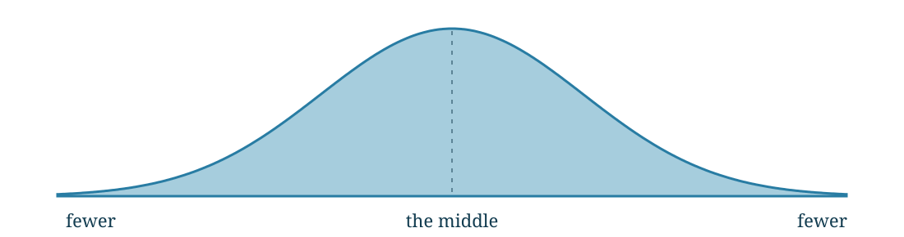

{slide #welcome no-enter}
> 
Luria / A guide to understanding scores

> <h1>A score is a starting point. Let’s find the meaning.</h1>
> 
A short conversation about comparisons, patterns, and what helps in everyday life.

> 
> 
5–10 minutes together · Teaching examples only · No patient data

{slide #comparison enter="~duration:0.4"}
> 
01 / The comparison

> <h2>Compared with whom?</h2>
> 
A test score becomes useful when we compare it with a relevant reference group.

> 

<h3>A fair starting point</h3>
Often, people of a similar age. Some tests account for other background factors.

<h3>Your context still matters</h3>
Language, learning opportunities, health, sleep, and the testing situation help us interpret the result.

> 
Your clinician will explain which comparison group was used.

> 
“What were you hoping this evaluation would help explain?”

{slide #curve enter="~duration:0.4"}
> 
02 / The bell curve

> <h2>Many scores gather near the middle.</h2>
> 
> 

<h3>Height means frequency</h3>
The taller middle represents more people. The lower ends represent fewer people.

<h3>A model, not a rule for every test</h3>
Many standardized scores use this shape. Some test results have a different distribution.

> 
“Normal distribution” names a mathematical shape. It does not label a person as normal or abnormal.

{slide #explore enter="~duration:0.4"}
> 
03 / Explore together

> <h2>Where does this score sit?</h2>
> <svg id="explorer-curve" class="curve" viewBox="0 0 1100 310" role="img" aria-label="Interactive normal distribution"></svg>
> 
<label for="score-slider">Move the score</label><input id="score-slider" type="range" min="-30" max="30" value="0"><button data-z="-1">One step below</button><button data-z="0">Middle</button><button data-z="1">One step above</button>

> 

Distance in SD<output id="z-value">0</output>

Standard score<output id="ss-value">100</output>

T score<output id="t-value">50</output>

Percentile rank ≈<output id="percentile-value">50</output>

> 

> 
Shading shows the share at or below the score. Ideal normal model; test-manual norms take priority. Click outside controls to resume arrow-key navigation.

{slide #percentile enter="~duration:0.4"}
> 
04 / A rank, not a grade

> <h2>The 16th percentile is not 16% correct.</h2>
> 

16 of 100

Roughly 16 out of 100 people in the reference group scored at or below this level.

<h3>Different questions</h3>
<strong>Percent correct:</strong> How many items did I answer correctly?

<strong>Percentile rank:</strong> Where does my performance sit in the comparison group?

> 
Percentiles are not equal steps: moving from 50 to 60 is a different score distance than moving from 90 to 100.

> 

Quick check: Does the 50th percentile mean half the answers were wrong?

No. It means the score is near the middle of the reference group.

{slide #rulers enter="~duration:0.4"}
> 
05 / Different rulers, same location

> <h2>Standard deviation is a unit of spread.</h2>
> 
One standard deviation (SD) is one step away from the mean, or center.

> <table><thead><tr><th>Common score ruler</th><th>One SD below</th><th>Middle</th><th>One SD above</th></tr></thead><tbody><tr><td>Standard score · SD 15</td><td>85</td><td>100</td><td>115</td></tr><tr><td>T score · SD 10</td><td>40</td><td>50</td><td>60</td></tr><tr><td>Scaled score · SD 3</td><td>7</td><td>10</td><td>13</td></tr><tr><td>Percentile · approximately</td><td>16th</td><td>50th</td><td>84th</td></tr></tbody></table>
> 
In a normal distribution, about 68% of scores fall within ±1 SD; about 95% fall within ±2 SD.

> 
These are common conventions, not rules for every test. A percentile is a rank, not an equal-interval score ruler.

{slide #ranges enter="~duration:0.4"}
> 
06 / Reading the report

> <h2>Range names are signposts.</h2>
> 
A report may use these words to describe where a performance score falls.

> 

<b>≤1</b>Exceptionally low

<b>2–8</b>Below average

<b>9–24</b>Low average

<b>25–74</b>Average

<b>75–90</b>High average

<b>91–97</b>Above average

<b>≥98</b>Exceptionally high

> 
Whole-number percentile bands for performance tests. Labels and cutoffs can differ across tests and reports.

> 
A boundary is not a cliff. Scores are estimates; measurement uncertainty matters near a cutoff.

> 
“Average” describes a comparison. It does not tell us everything about someone’s needs or strengths.

{slide #meaning enter="~duration:0.4"}
> 
07 / From numbers to meaning

> <h2>Uncommon does not automatically mean impaired.</h2>
> 

<h3>Statistical rarity</h3>
How unusual is this score in the reference group?

One low result can occur in healthy people, especially when many scores are collected.

<h3>Functional difficulty</h3>
What is hard in school, work, home life, or relationships?

We connect the pattern with history, observations, validity, and everyday experience.

> 
A low score alone does not establish a diagnosis. An average score alone does not rule out meaningful difficulty.

> 
On some symptom rating scales, a higher score means more concerns. Check the direction and meaning of each scale.

{slide #domains enter="~duration:0.4"}
> 
08 / From the whole picture to the details

> <h2>Look for a pattern across skills.</h2>
> 
Synthetic teaching profile · Select a domain · Bars show percentile ranks, not amount of ability

> 
<button data-domain="attention" aria-pressed="true">Attention</button><button data-domain="memory" aria-pressed="false">Learning & memory</button><button data-domain="reasoning" aria-pressed="false">Reasoning</button>

> 

> 
Broad domain → related skills → individual measures → everyday context.

> 
Fictional labels and values; no commercial test items or diagnostic conclusions. Apparent differences need clinical interpretation.

{slide #handoff enter="~duration:0.4"}
> 
09 / Your feedback conversation

> <h2>Now, let’s connect the dots.</h2>
> 

<h3>In Luria, we’ll ask…</h3>
What seems easier?

What takes more effort?

Which supports fit daily life?

<h3>Your perspective belongs here.</h3>
“Does this pattern match what you notice?”

“What would make the biggest difference this week?”

> 
Clinician handoff: switch to the appropriate case in Luria and open the domain score view.

> 
This teaching deck has no patient connection. Confirm the correct case and screen-sharing privacy before showing a real report.

> 
A score helps us ask better questions. The goal is useful understanding and support.

